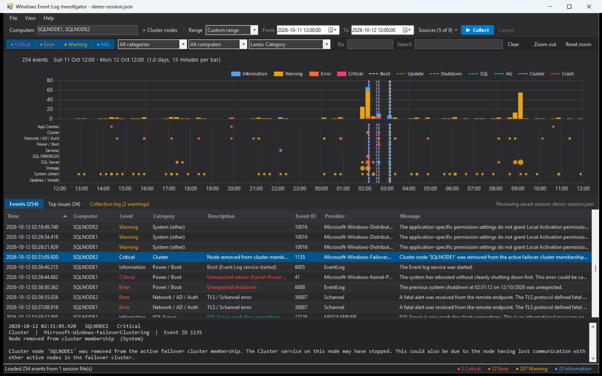
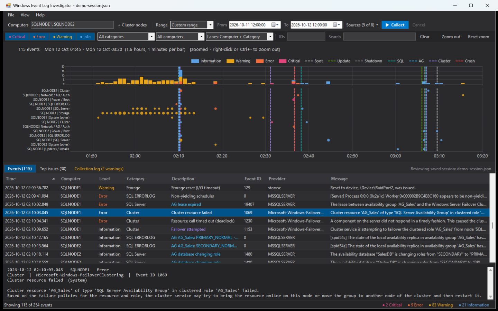
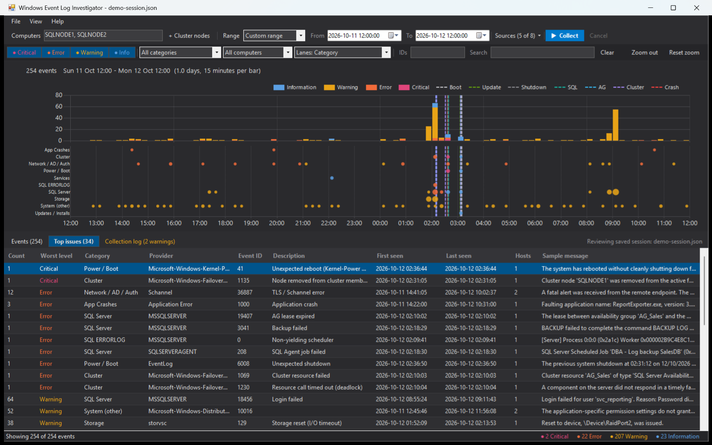
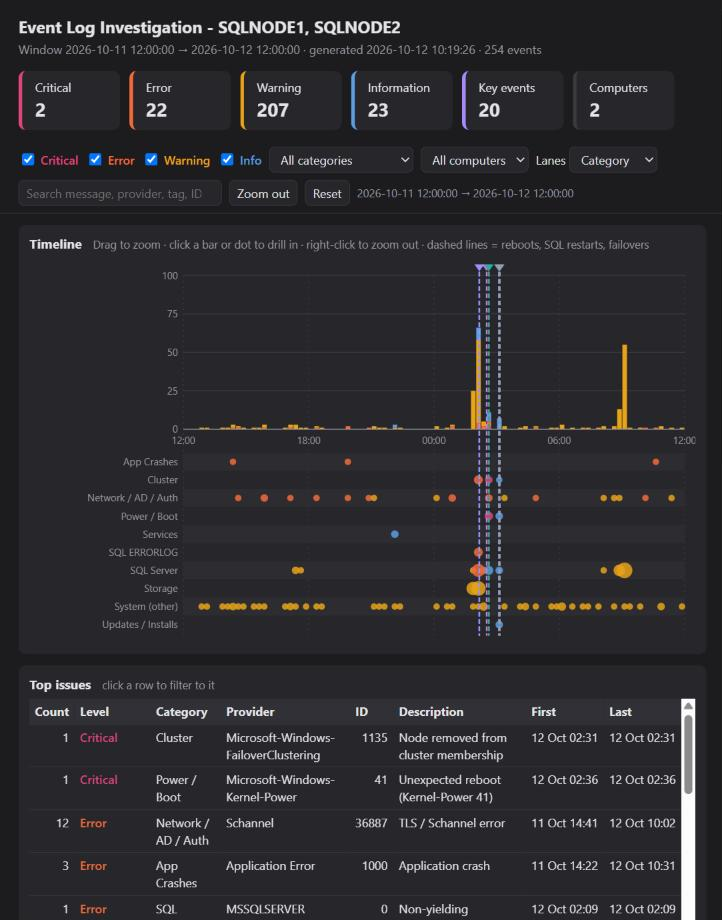

# Windows Event Log Investigator

A PowerShell tool for root-cause analysis on Windows, SQL Server and Failover Cluster hosts.
It collects problem events from one or more servers and puts them on an interactive timeline,
so you can see **when** things went wrong, **where** (which server and which subsystem) and **what** happened.
You can then drill down to the individual events.



*The bundled demo session: storage latency on SQLNODE1 at 02:00 leads to an AG failover, the node hangs
and is power-cycled, SQLNODE2 is patched and restarted at 03:00, and at 09:00 there is a storm of login failures.*

**Highlights**

* Collects from **every SQL Server instance, the SQL ERRORLOG and Agent logs, and the Failover Cluster logs**, plus System and Application,
  from several servers in parallel.
* **Timeline:** stacked problem counts, swim lanes per category, computer or provider, and marker lines for reboots, crashes,
  SQL restarts, failovers and patching. Drag to zoom, click to drill in.
* **Top issues:** recurring problems grouped by provider and event ID, worst first.
* **Sessions:** save everything you're looking at to one `.json` file and open it on another machine, with no access to the servers needed.
* Exports to CSV / Excel and a self-contained interactive HTML report.

## Quick start

```powershell
# GUI (Windows PowerShell 5.1, run as Administrator for the Security log and SQL ERRORLOG files)
.\WinEventLogInvestigator.ps1

# Try it without any servers: open the bundled demo session
.\WinEventLogInvestigator.ps1 -SessionPath .\samples\demo-session.json
```

In the GUI, enter the computers (or click **+ Cluster nodes**), pick a time range and the sources, then click **Collect** (F5).

## Screenshots

**Zoomed into the incident.** The lanes are grouped by *Computer + Category*. You can see the storage resets and slow I/O on SQLNODE1,
followed by the AG lease expiring, the cluster resource failing and the AG failing over to SQLNODE2. Then SQLNODE1 is removed from the
cluster and reboots unexpectedly, and later the role fails back while SQLNODE2 is patched.



**Top issues** groups everything in the current view by provider and event ID, worst level first, with counts, first and last seen,
and how many hosts are affected. Double-click a row to see those events.



**HTML report.** One self-contained file with the same timeline, KPIs, top issues and a searchable events table,
for attaching to an incident ticket.



## What it collects

| Source | What |
|---|---|
| **System** | All Critical / Error / Warning events, plus key events: boots (6005), clean / unexpected shutdowns (6006, 6008, Kernel-Power 41), planned restarts (1074), BSODs (1001), SQL / cluster related service changes (7036, 7040), Windows Update installs (19, 43) |
| **Application** | All Critical / Error / Warning events, plus installs / removals (MsiInstaller) and WER reports |
| **SQL Server events** | Every SQL provider registered in the Application log (all instances, Agent, SSIS, SSRS, VSS writer ...) including key informational events: start / stop (17126, 17147, 17148), AG role / state changes (1480, 19406, 19407, 35264), login failures (18456), slow I/O (833), I/O errors / corruption (823, 824, 825), log full (9002), non-yielding / deadlocked schedulers (17883, 17884, 17888), memory (701, 17890), backup failures (3041), Agent job failures (208) ... |
| **SQL ERRORLOG + Agent log** | Parses `ERRORLOG*` and `SQLAGENT.*` for every instance found in the registry. Error / severity lines are merged with their message, severity is mapped to a level, and duplicates of Application-log events are dropped |
| **Failover Cluster** | `FailoverClustering/Operational`, `FailoverClustering-Manager/Admin`, `FailoverClustering-CsvFs/Operational`, `ClusterAwareUpdating/Admin`, and cluster events in the System log (node removed 1135, quorum lost 1177, resource failed 1069, role moved 1641, CSV 5120/5142 ...) |
| Hyper-V, Security audit, OpsMgr | Optional |

Every event is classified into a **category** (SQL Server, Cluster, Storage, Network / AD / Auth,
Power / Boot, Services, Updates, App Crashes ...). Well-known IDs also get a plain-English
**description**. Key events (reboots, crashes, SQL restarts, failovers, AG changes, patching) become
dashed **marker lines** on the timeline.

## The timeline

* **Top:** stacked bars of Critical / Error / Warning / Information events per time bucket.
  The bucket size adapts from 10 seconds to 1 week as you zoom.
* **Bottom:** swim lanes per category, computer, computer + category, or provider. Each dot is sized by the number of
  events and coloured by the worst level in that bucket, so you can see which subsystem is failing and when.
* **Marker lines:** boots, unexpected shutdowns, SQL start / stop, cluster failovers, AG role changes and patching.
  Hover over any line, bar or dot for details.
* **Drag** to zoom, **click** a bar to drill into that bucket, **click** a dot to drill in and filter
  to that lane, **right-click** (or Ctrl+-) to zoom out. The events grid and the *Top issues* tab follow the zoomed window.

## Sessions: collect on one machine, review on another

**File > Save session** (Ctrl+S) writes everything you see to a single `.json` file:

* every collected event, with the full message text
* the collection log
* the collection settings: computers, time range, sources, the source server's UTC offset, who collected it and when
* your current view: level toggles, category, computer, lanes, Event ID filter, search, zoom window and the selected tab

**File > Open session** (Ctrl+O), dragging the file onto the window, or `-SessionPath` restores the same screen on any
machine. Nothing is needed from the original servers. Typical flow: run `-NoGui -OutputPath` on the server, or
collect in the GUI and save, then copy the `.json` to your desk. **File > Add session** (or Shift + drag) merges more
files into the current view, for example one exported from each cluster node. Duplicate events are skipped.

Times are kept as the source server's local time. When the reviewer is in a different time zone, the status bar says so.

## GUI

* **Collection bar:** computers, a range preset or custom From / To, a **Sources** drop-down (sources, *all Information events*,
  max events per query) and **Collect**. Every computer is collected in parallel, with progress in the status bar.
* **Filter bar:** level toggles, category, computer, lane grouping, Event IDs (`1069 1135` to include, `-7036` to exclude),
  search, Clear, Zoom out and Reset zoom.
* **Tabs:** *Events* (grid plus a details pane with the full message), *Top issues* and *Collection log*. The status bar shows
  counts per level for the current view.
* Right-click an event to show only or exclude its Event ID, or to zoom the timeline to ±15 minutes around it.
* **Exports:** CSV and Open in Excel export exactly what is displayed (filters and zoom). The HTML report applies the filters
  but keeps the full time range, with its own zoom. Save session stores every event plus the current view.
* **View menu:** hide the collection bar or the details pane to give the timeline and grid more room. Help > How to use (F1).

| Shortcut | |
|---|---|
| F5 | Collect |
| Ctrl+O / Ctrl+S | Open / save session |
| Ctrl+F, Esc | Search, clear search |
| Ctrl+- / Ctrl+0 | Zoom out / reset zoom |
| Ctrl+Shift+X | Clear filters |
| Ctrl+E / Ctrl+H | Export CSV / HTML report |
| F1 | How to use |

## Command line

```powershell
# GUI, pre-filled for an incident on two cluster nodes, collecting immediately
.\WinEventLogInvestigator.ps1 -ComputerName SQLNODE1,SQLNODE2 -StartTime '2026-10-11 22:00' -EndTime '2026-10-12 02:00' -AutoRun

# Headless on a server: session file + CSV + interactive HTML report + collection log
.\WinEventLogInvestigator.ps1 -Hours 72 -Sources System,SQL,SQLLogs,Cluster -NoGui -OutputPath C:\Temp\RCA

# Review saved sessions (several files are merged, e.g. one per node)
.\WinEventLogInvestigator.ps1 -SessionPath .\EventLogSession_SQLNODE1_20261012_093000.json,.\EventLogSession_SQLNODE2_20261012_093000.json

# Turn a session into CSV + HTML without the GUI
.\WinEventLogInvestigator.ps1 -SessionPath .\EventLogSession_SQLNODE1_20261012_093000.json -NoGui -OutputPath C:\Temp\RCA

# Headless, objects to the pipeline
.\WinEventLogInvestigator.ps1 -Hours 6 -NoGui | Where-Object LevelNum -le 2
```

| Parameter | Default | |
|---|---|---|
| `-ComputerName` | local | One or more servers |
| `-StartTime` / `-EndTime` / `-Hours` | last 24h | Time window |
| `-Sources` | System, Application, SQL, SQLLogs, Cluster | Also: HyperV, Security, OpsMgr |
| `-IncludeInformation` | off | Collect **all** Information events (noisy). Key informational events are always collected |
| `-MaxEventsPerQuery` | 5000 | Safety cap per log query. The collection log warns when it is hit |
| `-NoGui` / `-OutputPath` | | Headless mode. Writes a session `.json`, CSV, HTML report and collection log |
| `-SessionPath` | | Open one or more saved session files instead of collecting |
| `-AutoRun` | | GUI: start collecting on open |

## Requirements

* Windows PowerShell 5.1 for the GUI. Started from PowerShell 7, it relaunches itself in 5.1. Headless mode works in both.
* Run as Administrator to read the Security log and the SQL ERRORLOG folder. Everything else works without elevation.
* Remote collection:
  * Event logs: the *Remote Event Log Management* firewall rules enabled on the target.
  * SQL ERRORLOG / Agent logs: the *Remote Registry* service plus access to the admin shares (`\\server\D$`).
    On an FCI passive node the log folder lives on a disk that isn't mounted, which the collection log reports.
* For deep cluster analysis, also generate the cluster log: `Get-ClusterLog -TimeSpan <minutes>`.

The demo session in `samples/` and the screenshots use synthetic data from fictional servers.
