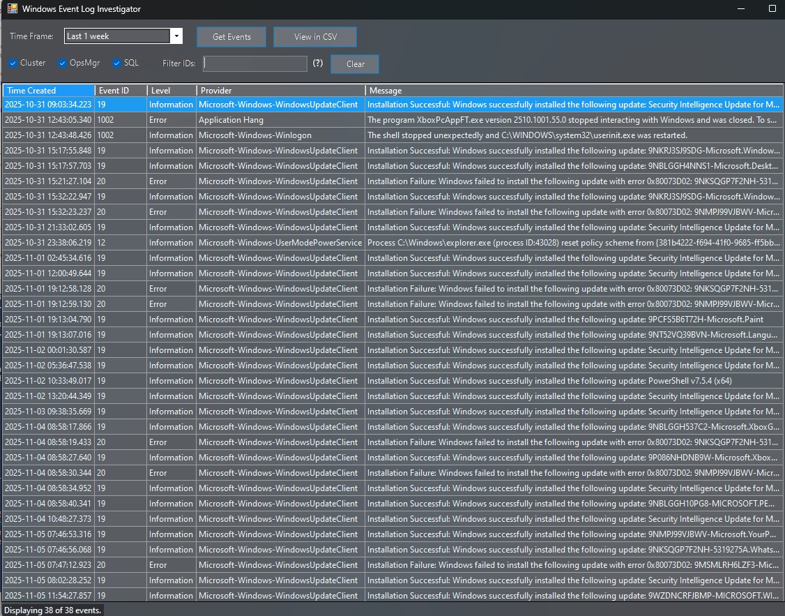

# Windows Event Log Investigator

A PowerShell tool for root-cause analysis on Windows / SQL Server / Failover Cluster hosts.
It collects problem events from one or more servers, puts them on an interactive timeline
so you can see **when** things went wrong, and lets you drill down to the individual events.



## What it collects

| Source | What |
|---|---|
| **System** | All Critical / Error / Warning events, plus key events: boots (6005), clean / unexpected shutdowns (6006, 6008, Kernel-Power 41), planned restarts (1074), BSODs (1001), SQL / cluster related service changes (7036, 7040), Windows Update installs (19, 43) |
| **Application** | All Critical / Error / Warning events, plus installs / removals (MsiInstaller) and WER reports |
| **SQL Server events** | Every SQL provider registered in the Application log (all instances, Agent, SSIS, SSRS, VSS writer, ...) incl. key informational events: start / stop (17126, 17147, 17148), AG role / state changes (1480, 19406, 19407, 35264), login failures (18456), slow I/O (833), I/O errors / corruption (823, 824, 825), log full (9002), non-yielding / deadlocked schedulers (17883, 17884, 17888), memory (701, 17890), backup failures (3041), Agent job failures (208) ... |
| **SQL ERRORLOG + Agent log** | Parses `ERRORLOG*` and `SQLAGENT.*` for every instance found in the registry. Error / severity lines are merged with their message, severity is mapped to a level, duplicates of Application-log events are dropped |
| **Failover Cluster** | `FailoverClustering/Operational`, `FailoverClustering-Manager/Admin`, `FailoverClustering-CsvFs/Operational`, `ClusterAwareUpdating/Admin`, and cluster events in the System log (node removed 1135, quorum lost 1177, resource failed 1069, role moved 1641, CSV 5120/5142 ...) |
| Hyper-V, Security audit, OpsMgr | Optional |

Every event is classified into a **category** (SQL Server, Cluster, Storage, Network / AD / Auth,
Power / Boot, Services, Updates, App Crashes ...) and, for well-known IDs, given a plain-English
**description**. Key events (reboots, crashes, SQL restarts, failovers, AG changes, patching) become
dashed **marker lines** on the timeline.

## The timeline

* **Top:** stacked bars of Critical / Error / Warning / Information events per time bucket
  (the bucket size adapts from 10 seconds to 1 week as you zoom).
* **Bottom:** swim lanes per category, computer or provider. Each dot is sized by the number of
  events and coloured by the worst level in that bucket, so you can see which subsystem is
  failing and when.
* **Marker lines:** boots, unexpected shutdowns, SQL start / stop, cluster failovers and AG role changes.
* **Drag** to zoom, **click** a bar to drill into that bucket, **click** a dot to drill in and filter
  to that lane, **right-click** to zoom out. The events grid and the *Top issues* tab follow the
  zoomed window.

## Usage

Run in Windows PowerShell 5.1, as Administrator. You need Administrator rights for the Security log and the
SQL ERRORLOG folder. Started from PowerShell 7, the GUI relaunches itself in 5.1.

```powershell
# GUI
.\WinEventLogInvestigator.ps1

# GUI, pre-filled for an incident on two cluster nodes, collecting immediately
.\WinEventLogInvestigator.ps1 -ComputerName SQLNODE1,SQLNODE2 -StartTime '2026-10-11 22:00' -EndTime '2026-10-12 02:00' -AutoRun

# Headless: CSV + interactive HTML report + collection log
.\WinEventLogInvestigator.ps1 -ComputerName SQLNODE1 -Hours 72 -Sources System,SQL,SQLLogs,Cluster -NoGui -OutputPath C:\Temp\RCA

# Headless, objects to the pipeline
.\WinEventLogInvestigator.ps1 -Hours 6 -NoGui | Where-Object LevelNum -le 2
```

| Parameter | Default | |
|---|---|---|
| `-ComputerName` | local | One or more servers. Use **+ Cluster nodes** in the GUI to add every node of a cluster |
| `-StartTime` / `-EndTime` / `-Hours` | last 24h | Time window. The GUI also offers presets and a custom range |
| `-Sources` | System, Application, SQL, SQLLogs, Cluster | Also: HyperV, Security, OpsMgr |
| `-IncludeInformation` | off | Collect **all** Information events (noisy). Key informational events are always collected |
| `-MaxEventsPerQuery` | 5000 | Safety cap per log query. The collection log warns when it is hit |
| `-NoGui` / `-OutputPath` | | Headless mode |
| `-AutoRun` | | GUI: start collecting on open |

### GUI features

* Filters for level, category, computer, Event IDs (`1069, 1135` to include, `-7036` to exclude) and free-text search.
* **Top issues** tab groups events by provider + ID with count, first / last seen and number of hosts. Double-click a row to show those events.
* Detail pane with the full message. Right-click a row to filter to or exclude its Event ID, or to zoom the timeline to ±15 minutes around it.
* **Open in Excel**, **Save CSV** and **HTML report**. The report is a single self-contained file
  with the same interactive timeline, top issues and searchable events table, ready to attach to an incident ticket.
* The **Collection log** tab shows what was queried on each server, how many events came back, and any problems
  (log not present, access denied, query cap reached).

### Remote collection requirements

* Event logs: *Remote Event Log Management* firewall rules enabled on the target.
* SQL ERRORLOG / Agent logs: *Remote Registry* service plus access to the admin shares (`\\server\D$`).
  On an FCI passive node the log folder lives on a disk that isn't mounted, which the collection log reports.
* For deep cluster analysis also generate the cluster log: `Get-ClusterLog -TimeSpan <minutes>`.
